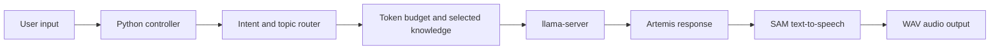

# Artemis Local LLM Voice Assistant


Artemis is an offline-first voice assistant prototype built around a local large language model, local knowledge files, and retro SAM text-to-speech. The current target is a Raspberry Pi 5 with 16 GB of RAM running Qwen2.5 1.5B Instruct through `llama.cpp`.

The project currently focuses on an Emergency Alert System-inspired personality. It routes each prompt by intent and topic, loads only the relevant local knowledge, keeps the prompt within a fixed token budget, requests a response from the local model, and renders the result to a WAV file through SAM.

## Current capabilities

- OpenAI-compatible local inference through `llama-server`
- Weighted intent, topic, and severity routing with fuzzy matching
- Selective loading of local knowledge instead of injecting every file
- Prompt and response token budgeting for Raspberry Pi constraints
- JSON-based identity and mode configuration
- Retro speech output through SAM
- Debug output for routing, prompt size, model timing, and token usage
- A lightweight router test that does not call the model or SAM

## How it works



The active request path is:

1. `load_llm_sam.py` loads the Artemis identity and active mode configuration.
2. `intent_router.py` scores the user's intent, topics, and urgency.
3. `token_budget.py` selects and trims relevant files from `memory/knowledge/`.
4. The controller sends the assembled prompt to the local `llama-server` endpoint.
5. The response is converted to a WAV file by SAM.

Inputs that receive no intent or topic score are logged to `unrecognized_inputs.txt` for later router tuning. They do not call the LLM.

## Project structure

```text
Python_Scripts/
  load_llm_sam.py    Main terminal application and prompt pipeline
  intent_router.py   Intent, topic, severity, and knowledge-file routing
  token_budget.py    Context and response token limits
memory/
  identity.json      Artemis identity and voice settings
  modes/             Mode definitions
  knowledge/         Local EAS lore, advisories, contacts, and protocols
Archive/             Older experiments and tests kept for reference
```

## Requirements

- Python 3.9 or newer
- [`rapidfuzz`](https://github.com/rapidfuzz/RapidFuzz)
- A local [`llama.cpp`](https://github.com/ggml-org/llama.cpp) build containing `llama-server`
- [Qwen2.5 1.5B Instruct GGUF](https://huggingface.co/Qwen/Qwen2.5-1.5B-Instruct-GGUF), currently using the `Q4_K_M` quantization
- [SAM: Software Automatic Mouth](https://github.com/s-macke/SAM)

The current hardware target is a Raspberry Pi 5 with 16 GB of RAM. Development and router testing can be done elsewhere, but the default SAM paths are Pi-specific.

## Setup

Clone the repository and install the Python dependency:

```bash
git clone https://github.com/Ace0I0/Local_LM_testing.git
cd Local_LM_testing
python3 -m venv .venv
source .venv/bin/activate
python -m pip install rapidfuzz
```

Download `qwen2.5-1.5b-instruct-q4_k_m.gguf` from the model page linked above, then start the local server:

```bash
~/llama.cpp/build/bin/llama-server \
  -m ~/models/qwen/qwen2.5-1.5b-instruct-q4_k_m.gguf \
  --host 127.0.0.1 \
  --port 8080 \
  -c 8192
```

Build SAM separately and confirm these constants in `Python_Scripts/load_llm_sam.py` match your installation:

```python
LLAMA_SERVER_URL = "http://127.0.0.1:8080/v1/chat/completions"
SAM_BINARY = Path("/home/pi/SAM/sam")
OUTPUT_WAV = Path("/home/pi/SAM/robot_response.wav")
```

Run Artemis from the repository root:

```bash
python Python_Scripts/load_llm_sam.py
```

## Router test

The current controller includes a small routing check that does not require a running model server or SAM installation:

```bash
python Python_Scripts/load_llm_sam.py --router-test
```

## Current status and limitations

- EAS Mode is the only mode wired into the controller; its path is currently hardcoded.
- Learning and Informational mode JSON files are drafts and are not selectable at runtime.
- `memory/active_mode.txt` is not yet used by the controller.
- Microphone input, wake-word detection, and physical robot controls are not implemented.
- SAM and output paths are currently hardcoded for `/home/pi/SAM/`.
- The files under `Archive/` are historical references, not the active test suite.

## Near-term direction

The next project direction has intentionally been left open. Likely areas include improving local inference performance, making modes selectable, strengthening retrieval and memory, adding voice input, or developing the physical assistant interface after the LLM pipeline is mature.

## Credits

- [`llama.cpp`](https://github.com/ggml-org/llama.cpp) for local LLM inference
- [`Qwen2.5`](https://huggingface.co/Qwen/Qwen2.5-1.5B) for the language model
- [`SAM`](https://github.com/s-macke/SAM) for retro text-to-speech
- Raspberry Pi Foundation for the target hardware platform
