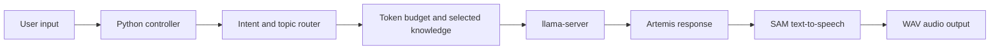

# Artemis Local LLM Voice Assistant


Artemis is an offline-first voice assistant prototype built around a local large language model, local knowledge files, and retro SAM text-to-speech. The current target is a Raspberry Pi 5 with 16 GB of RAM running Qwen2.5 1.5B Instruct through `llama.cpp`.

The project currently focuses on an Emergency Alert System-inspired personality. It routes each prompt by intent and topic, loads only the relevant local knowledge, keeps the prompt within a fixed token budget, requests a response from the local model, and renders the result to a WAV file through SAM.

## Current capabilities

- OpenAI-compatible local inference through `llama-server`
- Weighted intent, topic, and severity routing with fuzzy matching
- Selective loading of local knowledge instead of injecting every file
- Prompt and response token budgeting for Raspberry Pi constraints
- JSON-based identity and mode configuration
- Retro speech output through SAM
- Debug output for routing, prompt size, model timing, and token usage
- A lightweight router test that does not call the model or SAM
- Read-only MQTT temperature and humidity answers that bypass the LLM

## How it works



The active request path is:

1. `load_llm_sam.py` loads the Artemis identity and active mode configuration.
2. `intent_router.py` scores the user's intent, topics, and urgency.
3. `token_budget.py` selects and trims relevant files from `memory/knowledge/`.
4. The controller sends the assembled prompt to the local `llama-server` endpoint.
5. The response is converted to a WAV file by SAM.

Inputs that receive no intent or topic score are logged to `unrecognized_inputs.txt` for later router tuning. They do not call the LLM.

## Project structure

```text
Python_Scripts/
  load_llm_sam.py    Main terminal application and prompt pipeline
  intent_router.py   Intent, topic, severity, and knowledge-file routing
  token_budget.py    Context and response token limits
memory/
  identity.json      Artemis identity and voice settings
  modes/             Mode definitions
  knowledge/         Local EAS lore, advisories, contacts, and protocols
Archive/             Older experiments and tests kept for reference
```

## Requirements

- Python 3.9 or newer
- [`rapidfuzz`](https://github.com/rapidfuzz/RapidFuzz)
- [`paho-mqtt`](https://github.com/eclipse-paho/paho.mqtt.python)
- A local [`llama.cpp`](https://github.com/ggml-org/llama.cpp) build containing `llama-server`
- [Qwen2.5 1.5B Instruct GGUF](https://huggingface.co/Qwen/Qwen2.5-1.5B-Instruct-GGUF), currently using the `Q4_K_M` quantization
- [SAM: Software Automatic Mouth](https://github.com/s-macke/SAM)

The current hardware target is a Raspberry Pi 5 with 16 GB of RAM. Development and router testing can be done elsewhere, but the default SAM paths are Pi-specific.

## Setup

Clone the repository and install the Python dependency:

```bash
git clone https://github.com/Ace0I0/Local_LM_testing.git
cd Local_LM_testing
python3 -m venv .venv
source .venv/bin/activate
python -m pip install -r requirements.txt
```

Download `qwen2.5-1.5b-instruct-q4_k_m.gguf` from the model page linked above, then start the local server:

```bash
~/llama.cpp/build/bin/llama-server \
  -m ~/models/qwen/qwen2.5-1.5b-instruct-q4_k_m.gguf \
  --host 127.0.0.1 \
  --port 8080 \
  -c 8192
```

Build SAM separately and confirm these constants in `Python_Scripts/load_llm_sam.py` match your installation:

```python
LLAMA_SERVER_URL = "http://127.0.0.1:8080/v1/chat/completions"
SAM_BINARY = Path("/home/pi/SAM/sam")
OUTPUT_WAV = Path("/home/pi/SAM/robot_response.wav")
```

Run Artemis from the repository root:

```bash
python Python_Scripts/load_llm_sam.py
```

## Compare local models

The GGUF file and llama-server both run locally. Artemis talks to the
loopback HTTP endpoint; it does not send prompts to an internet service.
Benchmark one model at a time so the models do not compete for CPU or RAM.

Start llama-server with a model, then record its run:

    python scripts/benchmark_llms.py run --label qwen2.5-1.5b

Stop the server, restart it with the next GGUF, and repeat with
--label qwen3.5-2b and --label qwen3.5-4b. Each run uses the same
18 prompts, one warm-up, and three measured repetitions by default.
If the server is elsewhere, pass its full chat-completions URL:

    python scripts/benchmark_llms.py run \
      --label qwen3.5-2b \
      --url http://SERVER_ADDRESS:8080/v1/chat/completions

Compare the three timestamped JSON results:

    python scripts/benchmark_llms.py compare \
      benchmark-results/qwen2.5-1.5b-*.json \
      benchmark-results/qwen3.5-2b-*.json \
      benchmark-results/qwen3.5-4b-*.json

The Markdown report shows errors, automated response checks, wall time,
token usage, llama.cpp prompt and generation TPS when supplied by the
server, calculated end-to-end output TPS, and every raw answer. Generated
results remain under the ignored benchmark-results directory.

## MQTT broker setup

The first MQTT slice assumes the broker is running on the target Raspberry Pi: ARM64 (`aarch64`), Debian 13, and a trusted local network. From an interactive SSH session on the Pi, update this branch and run the setup wizard from the repository root:

```bash
bash scripts/setup_mosquitto.sh
```

The wizard installs Mosquitto, creates any missing Artemis MQTT accounts, enables the service, and verifies authenticated MQTT 5 publish/subscribe behavior locally and through the Pi's LAN address. It owns these files:

- `/etc/mosquitto/conf.d/artemis.conf`
- `/etc/mosquitto/artemis.passwd`
- `/etc/mosquitto/artemis.acl`

The password file contains usernames and password hashes, while the ACL file contains their permissions. MQTT topics such as `artemis/sensors/living_room/status` are broker addresses, not directories. Retained topic values live in Mosquitto's persistence database when persistence is enabled by Debian's broker configuration.

The wizard provisions these least-privilege accounts:

| Account | Access |
| --- | --- |
| `artemis_test` | Read/write under `artemis/test/#` |
| `esphome_living_room` | Publish the living-room temperature, humidity, availability, and discovery messages; read `homeassistant/status` |
| `homeassistant` | Read sensor and discovery messages; publish `homeassistant/status` |
| `artemis` | Read temperature, humidity, and availability only |

Choose and save a different password for each account. `mosquitto_passwd` asks twice when creating a missing account, and the verification stage asks once more for each password. Input is hidden. Existing account hashes and unrelated users are preserved on reruns; a successful run ends with `Setup complete`.

The verification publishes retained QoS 1 sample values for `living_room` (`21.5` °C, `45.0`% humidity, and `online`), checks each permitted consumer, rejects cross-location and write attempts, restarts Mosquitto to prove retention, and repeats the test-account check over the Pi's LAN address.

## Artemis sensor questions

Artemis uses Paho MQTT to subscribe in the background with the read-only `artemis` account. Run the application normally and enter that account's MQTT password at the hidden prompt:

```bash
python Python_Scripts/load_llm_sam.py
```

For unattended startup, `ARTEMIS_MQTT_PASSWORD` may be supplied through the process environment. Never commit it or place it directly in a shell command. RapidFuzz handles question routing; Paho maintains the MQTT 5 connection and automatically reconnects when the local broker returns.

Initial supported questions include:

- `What is the living room temperature?`
- `What is the living room temperature in Celsius?`
- `What is the humidity?`
- `How are conditions in the living room?`

MQTT measurements remain Celsius internally. Artemis presents Fahrenheit by default and uses Celsius when requested explicitly. A measurement becomes unavailable after 180 seconds without an update. General condition reports omit unavailable measurements; a direct question says only that no current reading is available. Broker downtime does not stop non-sensor questions.

The setup wizard's retained sample is accepted when Artemis starts, but it becomes unavailable after 180 seconds because it is not a live sensor. The future ESPHome node will refresh it every 60 seconds.

Run the local checks with:

```bash
PYTHONDONTWRITEBYTECODE=1 PYTHONPATH=Python_Scripts python3 -m unittest discover -s tests -p 'test_*.py' -v
bash tests/test_setup_mosquitto.sh
python3 Python_Scripts/load_llm_sam.py --router-test
```

## Router test

The current controller includes a small routing check that does not require a running model server or SAM installation:

```bash
python Python_Scripts/load_llm_sam.py --router-test
```

## Current status and limitations

- EAS Mode is the only mode wired into the controller; its path is currently hardcoded.
- Learning and Informational mode JSON files are drafts and are not selectable at runtime.
- `memory/active_mode.txt` is not yet used by the controller.
- Microphone input, wake-word detection, and physical robot controls are not implemented.
- SAM and output paths are currently hardcoded for `/home/pi/SAM/`.
- The files under `Archive/` are historical references, not the active test suite.

## Near-term direction

Artemis is moving toward a local, read-only smart-home helper. The first milestone will use MQTT and Mosquitto to observe basic sensors, with Home Assistant as the primary dashboard. Artemis, the broker, and Home Assistant will initially share one Raspberry Pi 5.

The ongoing questions and confirmed decisions are recorded in [`docs/project-direction-interview.md`](docs/project-direction-interview.md).

## Credits

- [`llama.cpp`](https://github.com/ggml-org/llama.cpp) for local LLM inference
- [`Qwen2.5`](https://huggingface.co/Qwen/Qwen2.5-1.5B) for the language model
- [`SAM`](https://github.com/s-macke/SAM) for retro text-to-speech
- Raspberry Pi Foundation for the target hardware platform
